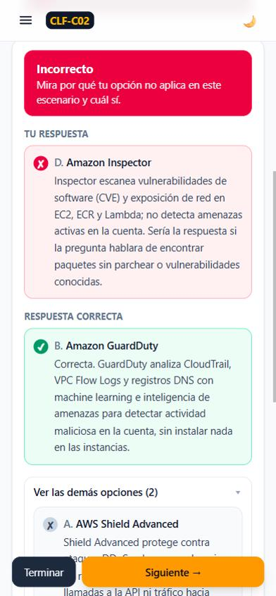

# Estudio AWS Certified Cloud Practitioner (CLF-C02)

Aplicación web en español para preparar el examen **AWS Certified Cloud Practitioner (CLF-C02)**. Es un sitio 100 % estático: no tiene backend ni base de datos y cada persona guarda su progreso en su propio navegador.

| | |
|---|---|
| Flashcards | 321 (repetición espaciada Leitner de 5 cajas) |
| Preguntas tipo examen | 232 (21 de respuesta múltiple) |
| Preguntas "¿Qué servicio es?" | 108 |
| Comparaciones clave | 13 tablas |

Reparto de las preguntas de examen por dominio: D1 Conceptos 47 · D2 Seguridad 66 · D3 Tecnología 88 · D4 Facturación 31.

## Funcionalidades

- **Flashcards**: la tarjeta se voltea con clic, la tecla Espacio o deslizando el dedo. Filtros por dominio, sección y tipo. Botones "No la sabía / Dudé / La sabía" (o teclas 1, 2 y 3) y modo "solo las que fallo".
- **¿Qué servicio es?**: un caso de uso con 4 servicios como opciones.
- **Práctica por tema**: preguntas tipo examen por sección o dominio, con retroalimentación inmediata.
- **Simulador**: 65 preguntas repartidas según los pesos oficiales (16/19/22/8) y 90 minutos. Puedes marcar preguntas para revisar y usar el navegador de preguntas. Al final ves el puntaje estimado sobre 1000, el resultado por dominio y la revisión completa.
- **Mis errores**: todas las preguntas falladas en cualquier modo. Una pregunta sale de la lista al acertarla 2 veces seguidas.
- **Comparaciones clave**: CloudWatch vs CloudTrail vs Config, SG vs NACL, servicios de seguridad, opciones de compra de EC2, clases de S3, planes de soporte, responsabilidad compartida, Well-Architected, CAF, 7 Rs y más.
- **Estadísticas**: dominio por sección y por dominio del examen, racha de días y preguntas más falladas.
- **Importar y respaldo**: pega o carga un JSON con contenido nuevo (se valida antes de guardarlo) y exporta o importa tu progreso.

**Retroalimentación:** cada opción de cada pregunta tiene su propia explicación. Cuando una opción incorrecta es otro servicio de AWS, la explicación dice qué hace realmente ese servicio y en qué escenario sí sería la respuesta correcta.



**Para que no sea repetitivo:** las opciones se barajan en cada sesión, la práctica y el simulador priorizan las preguntas que has visto menos, y cada simulacro es distinto.

## Correr el proyecto localmente

Requisitos: [Node.js](https://nodejs.org/) 22.18 o superior (se usa Node 24). El script de validación ejecuta TypeScript directamente con Node.

```bash
npm install
```

```bash
npm run dev
```

Abre http://localhost:5173. Otros comandos:

```bash
npm run validate:data
```

```bash
npm run build
```

```bash
npm run preview
```

`npm run build` valida primero el contenido: si hay un error en los JSON, el build falla.

## Desplegar en GitHub Pages (recomendado)

El repo ya incluye el workflow `.github/workflows/pages.yml`.

1. Crea un repositorio en GitHub y sube el código:
   ```bash
   git remote add origin https://github.com/TU_USUARIO/aws-clf-c02-estudio.git
   ```
   ```bash
   git push -u origin main
   ```
2. En GitHub, ve a **Settings → Pages → Build and deployment** y en **Source** elige **GitHub Actions**.
3. Cada `push` a `main` compila y publica el sitio. La URL aparece en la pestaña **Actions** y en **Settings → Pages** (algo como `https://TU_USUARIO.github.io/aws-clf-c02-estudio/`).

La app usa `HashRouter` (las rutas van después de `#`) y `base: './'` en Vite, así que funciona en una subcarpeta y recargar cualquier página nunca da 404.

## Desplegar en Render (Static Site)

El archivo `render.yaml` ya define el sitio: runtime `static`, `buildCommand: npm ci && npm run build`, `staticPublishPath: ./dist` y una regla de rewrite `/*` → `/index.html`.

1. Sube el proyecto a un repositorio de GitHub (pasos de arriba).
2. Entra en [dashboard.render.com](https://dashboard.render.com) e inicia sesión con GitHub.
3. Pulsa **New → Blueprint**, elige el repositorio y confirma. Render lee `render.yaml` y crea el Static Site.
   - Alternativa manual: **New → Static Site**, elige el repo, Build Command `npm ci && npm run build`, Publish Directory `dist`. En **Redirects/Rewrites** añade Source `/*`, Destination `/index.html`, Action `Rewrite`.
4. Pulsa **Deploy**. Cada `push` a la rama principal vuelve a desplegar.

## Otras alternativas gratuitas

| Servicio | Configuración |
|---|---|
| **Netlify** | Build command `npm run build`, publish directory `dist`. No hace falta configurar redirecciones porque se usa HashRouter. |
| **Vercel** | Framework "Vite", build `npm run build`, output `dist`. |
| **Cloudflare Pages** | Build `npm run build`, output `dist`. |

## Agregar más flashcards o preguntas

El contenido está en `src/data/flashcards.json` y `src/data/questions.json`. Las preguntas de "¿Qué servicio es?" van en `questions.json` con `"mode": "servicio"`.

### Formato de una flashcard

```json
{
  "id": "s3-023",
  "domain": 3,
  "section": "Amazon S3",
  "type": "concepto",
  "front": "Pregunta o concepto",
  "back": "Respuesta con tus propias palabras",
  "tags": ["s3"],
  "difficulty": 1,
  "note": "Opcional: aviso si el servicio fue retirado"
}
```

- `type`: `concepto`, `comparacion`, `caso-de-uso` o `dato-clave`.
- `difficulty`: 1, 2 o 3.

### Formato de una pregunta

```json
{
  "id": "q-s3-015",
  "domain": 3,
  "section": "Amazon S3",
  "mode": "examen",
  "type": "single",
  "selectCount": 1,
  "stem": "Una empresa necesita...",
  "options": [
    { "id": "a", "text": "Opción", "explanation": "Por qué es correcta o incorrecta en ESTE escenario (mínimo 40 caracteres)" },
    { "id": "b", "text": "Opción", "explanation": "..." }
  ],
  "correct": ["a"],
  "summary": "Idea clave para recordar",
  "refs": ["https://docs.aws.amazon.com/..."],
  "source": "original"
}
```

- Para respuesta múltiple: `"type": "multiple"`, `"selectCount": 2` y dos ids en `correct`.
- `section` debe ser una de las secciones de `src/data/meta.ts`.
- Si una opción incorrecta es otro servicio, explica qué hace y cuándo sí sería la respuesta.

### Dos formas de añadir contenido

1. **Directamente en el repo:** crea un archivo `lote.json` con `{ "flashcards": [...], "questions": [...] }` y ejecuta:
   ```bash
   npm run merge:batch -- lote.json
   ```
   ```bash
   npm run validate:data
   ```
   El script agrega los elementos nuevos y reemplaza los que tengan el mismo `id`.
2. **Desde la app:** en **Importar y respaldo**, pega el JSON y pulsa *Validar* y luego *Guardar*. El contenido queda solo en tu navegador. Para compartirlo con tus compañeros, pulsa *Exportar contenido importado* y añade el archivo al repo con `merge:batch`.

### Reglas del validador (`npm run validate:data`)

Falla si hay:
- IDs repetidos o campos obligatorios ausentes;
- un valor de `correct` que no existe en las opciones;
- un `selectCount` que no coincide con el número de respuestas correctas;
- un dominio fuera del rango 1 a 4;
- una opción sin `explanation` o con menos de 40 caracteres;
- una pregunta sin `summary`.

## Tu progreso

Se guarda en `localStorage` de tu navegador (clave `clf-progress-v1`). Si borras los datos del navegador lo pierdes, así que exporta un respaldo de vez en cuando desde **Importar y respaldo**. El archivo exportado sirve también para pasar el progreso a otro dispositivo.

## Sobre el contenido

- Todo el contenido está escrito desde cero. El material del curso que se usó como guía de temas es privado: vive en `material-privado/`, que está en `.gitignore` y nunca se sube al repo ni al despliegue.
- Los servicios retirados o cerrados a clientes nuevos llevan una nota ⚠️: Snowmobile, Snowcone, Snowball Edge, QLDB, CodeGuru Reviewer, Migration Hub, Application Discovery Service, Pinpoint, AWS IQ, Timestream for LiveAnalytics y Simple AD. CodeCommit también lleva nota porque volvió a estar disponible en nov-2025.
- Los planes de soporte cambiaron en 2025 (Business Support+, Enterprise, Unified Operations). Las preguntas siguen el temario del examen y lo indican con una nota.
- Revisa siempre la [guía oficial del examen CLF-C02](https://docs.aws.amazon.com/aws-certification/latest/examguides/cloud-practitioner-02.html). El puntaje del simulador es una estimación lineal, no la escala oficial de AWS.

## Stack

Vite 6 · React 18 · TypeScript · Tailwind CSS 4 · React Router (HashRouter). Sin dependencias de backend.
